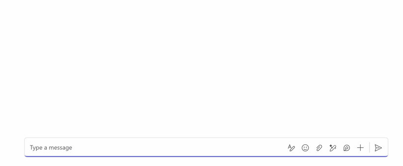
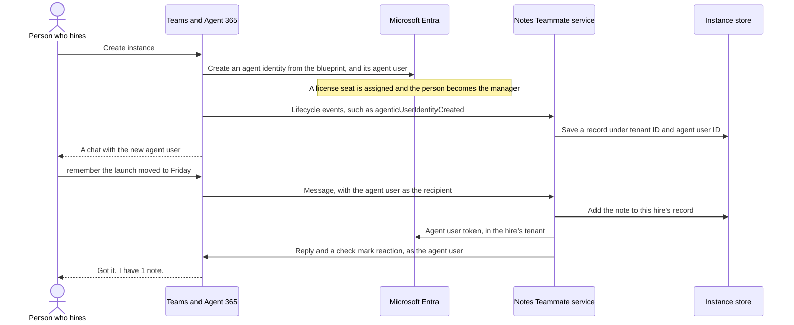
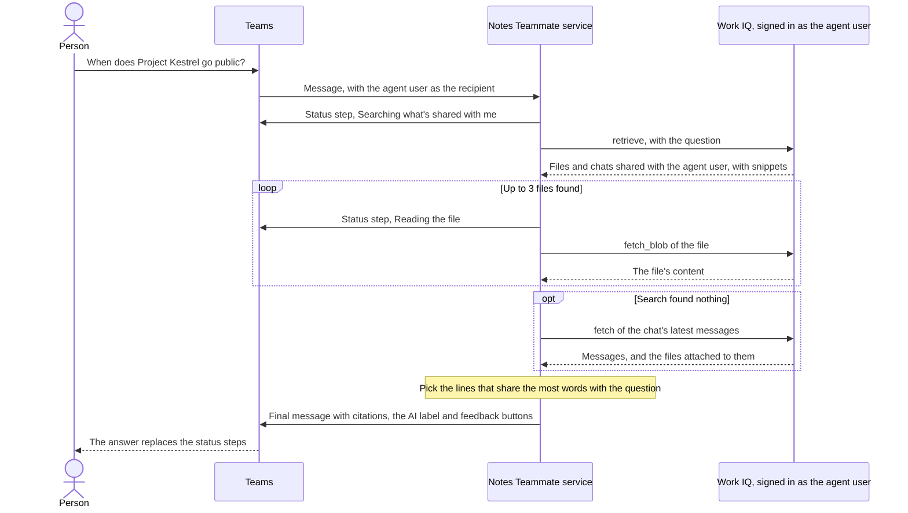

# Agentic user hire sample

This C# sample is Notes Teammate, a Teams agent that people hire from the Agent Store in Microsoft 365. A hire remembers the notes people send it and answers questions from files shared with it, with a citation for each file. Every hire keeps its own data. It's a starting point, not a production design.

Each hire runs as its own agent user, with its own name, mailbox and manager, but you deploy one service and one agent identity blueprint for all of them. The sample shows a simple way for that one service to keep each hire's data apart.



## What it shows

- Keeping each hire's data apart, under an instance key made of the tenant ID and agent user ID of the message's recipient.
- Handling Agent 365 lifecycle events, such as a hire, a pause, a delete and a restore.
- Answering questions through Work IQ, signed in as the hire's agent user, with a citation for each file it quotes.
- Replying with Teams features: citations, status steps while it searches, suggested replies, reactions, the AI label and feedback buttons.
- Serving hires in other tenants, with a multitenant blueprint.

## How it works

Each hire is identified by its tenant ID and agent user ID. The code calls this the instance key.

- Every message says which hire it's for in `activity.Recipient`. The key comes from there, never from the sender or the message text.
- Each hire's data is stored under its key, in `data/<tenant id>/<agent user id>.json`. Keys must be GUIDs, so a key can't point at another folder.
- Lifecycle events keep the record current: created (who hired it), disabled and enabled (pause and resume), deleted (its notes are deleted and a small marker is kept) and restored (the hire starts over). The other lifecycle events are only logged.
- Check the hire's state on every message, not only in the lifecycle handlers. A paused or deleted hire stays silent, and a deleted hire keeps a small marker so a message that reaches it later doesn't start a new record.
- Replies are sent as the agent user that got the message, so each hire answers as itself.
- To answer "who are you", a hire reads its own profile through the [Work IQ API](https://learn.microsoft.com/microsoft-365/copilot/extensibility/work-iq/enable-work-iq), signed in as its agent user.
- Ask a hire something that ends with a question mark and it searches what has been shared with its agent user, using Work IQ's `retrieve` tool. It reads the files it finds and replies with the lines that share the most words with the question, with a citation for each file. If the search finds nothing, it looks through the chat's messages and the files attached to them. There's no language model, so answers are quoted lines, not summaries. A hire only finds what has been shared with it, so Microsoft 365 sharing keeps hires apart here too.
- At run time, everything a hire reads goes through Work IQ as its agent user. The Work IQ paths it uses, such as `/me` and `/chats/{id}/messages`, are hard-coded for now. The recommended approach is to discover them at run time with Work IQ's `search_paths` and `get_schema` tools.

| Path | What it shows |
| --- | --- |
| `src/NotesTeammate/InstanceKey.cs` | Getting the key from the recipient |
| `src/NotesTeammate/InstanceStore.cs` | One file per hire |
| `src/NotesTeammate/TeamsRoutes.cs` | Lifecycle events and messages |
| `src/NotesTeammate/Teammate.cs` | What a hire does with its own data |
| `src/NotesTeammate/AgentDirectory.cs` | Reading its own profile through Work IQ |
| `src/NotesTeammate/WorkIq.cs` | Calling Work IQ as the agent user |
| `src/NotesTeammate/AnswerFinder.cs` | Answering from files shared with the hire, then from the chat |
| `src/NotesTeammate/TextMatch.cs` | Picking the lines that answer a question |
| `src/NotesTeammate/TeamsReply.cs` | Markdown, citations, feedback and the AI label on a reply |
| `src/NotesTeammate/StatusStream.cs` | Showing each step while a hire searches |
| `src/NotesTeammate/HireTenant.cs` | Serving hires in any tenant |
| `src/NotesTeammate/ActivityLog.cs` | Logging every activity and lifecycle event, in Development only |
| `tests/NotesTeammate.Tests` | Two hires never share data, in one tenant or across tenants |
| `appPackage` | App package with the agentic user template |
| `tools/Setup` | Creates the blueprint and test hires in your tenant |

### A hire and a note



### A question

In a 1:1 chat:



### Replies in Teams

Replies use the Teams features that suit quoted answers:

- Replies are markdown, so an answer comes as a short list.
- In a 1:1 chat, the hire shows each step while it works, such as "Searching what's shared with me", and the answer replaces the steps. Streaming is for 1:1 chats, so in a group chat it reacts to the question with eyes while it searches and removes the reaction when it answers.
- Each line of an answer has a numbered citation. Selecting it shows the file name with an icon for its type, a few keywords from the question and the quoted lines, with a link to the file.
- Answers carry the AI generated label and like and dislike buttons. The sample only logs the feedback, in `OnFeedbackAsync` in `TeamsRoutes.cs`.
- When a hire saves a note, it reacts to your message with a check mark.
- In 1:1 chats, replies suggest what to send next, such as "notes". Treat suggestions as shortcuts, and make sure everything they offer also works when typed.

## Prerequisites

- .NET 10 SDK
- A tunnel to your machine, such as [dev tunnels](https://learn.microsoft.com/azure/developer/dev-tunnels/get-started).
- A Microsoft 365 test tenant where you're a Global Administrator, with the licenses and setup below.

### Licenses

- Each hire needs one seat of a Microsoft 365 license for agents that includes Teams, such as Microsoft 365 Frontier for Autopilots (Non EEA). It goes to the hire's agent user, not to a person. It's assigned when someone hires, from the agent's Licenses tab in the admin center, and deleting the hire frees it. If no seat is free, Teams says "You don't have the required license to create this agent". Microsoft 365 E7 doesn't count as one.
- The person who hires needs Teams, and the agent must be published to them. Teams checks the tenant's free seats, not the hirer's licenses, and Microsoft 365 Copilot doesn't have to be assigned to them. Agent 365 is licensed per person rather than per agent, so the hire's manager needs Agent 365, either in Microsoft 365 E7 or on its own. In Teams, the person who hires becomes the manager.
- The admin needs Microsoft 365 E7. It includes Microsoft 365 Copilot, which the Copilot Frontier setting needs, and Agent 365.

### Tenant setup

Do this once in each tenant that hires the agent, as a Global Administrator, in the [Microsoft 365 admin center](https://admin.microsoft.com).

1. Turn on Agent 365 Frontier. With E7 assigned to you, open Copilot, then Settings, and set Copilot Frontier to All users or to the people who will hire. The setting can take up to 3 hours to apply (see [How long it takes](#how-long-it-takes)). See [Agent 365 Frontier](https://learn.microsoft.com/microsoft-agent-365/frontier).
2. Buy seats for hires. In Marketplace, open Microsoft Agent 365 Frontier, choose Microsoft 365 Frontier for Autopilots and buy one seat per hire.
3. Turn on the Work IQ API. Work IQ is billed in Copilot Credits to the tenant the hire lives in, so every tenant that hires needs this.
   - The tenant needs the Work IQ service principal. Create it with `az ad sp create --id fdcc1f02-fc51-4226-8753-f668596af7f7`. A conflict error means it's already there. See [Enable your tenant for Work IQ](https://learn.microsoft.com/microsoft-365/copilot/extensibility/work-iq/enable-work-iq).
   - Open Copilot, then Cost management, and select Get started. Choose the Azure subscription to bill. If there isn't one, a Global Administrator can create Microsoft 365 Default Subscription from the list. Set a monthly limit at or above the minimum the admin center shows. Under Customize setup, choose Work IQ API for custom apps and agents, then select Activate. See [Copilot Credits billing](https://learn.microsoft.com/microsoft-365/copilot/usage-based-billing-overview-copilot-credits).
   - To check it, send "who are you" to a hire once it's running. It answers with its own name and address through Work IQ. If it answers "I couldn't read my own profile", the console says why.

### How long it takes

Some setup changes take time to apply, so make them well before you need them, especially before a demo.

| Step | Allow |
| --- | --- |
| Copilot Frontier shows in Settings after E7 is assigned | A few minutes |
| Copilot Frontier applies after you save it | Up to 3 hours, as the Copilot Frontier panel says. Until then, uploading an agent with a blueprint says "Blueprint agents are only supported in Frontier tenants" |
| The agent shows in Teams after you publish it | A few minutes |
| Create instance is available after you buy seats | A few minutes. Reload the admin center to see new seats |
| A new hire is ready to chat | Under a minute. Teams sends a notification |

## Run it

Run the commands from the repository root.

1. Run the tests. They don't need a tenant.

   ```
   dotnet test
   ```

2. Create the blueprint. A browser opens so you can sign in as an admin. The client secret goes to [.NET user secrets](https://learn.microsoft.com/aspnet/core/security/app-secrets), not the repository.

   ```
   dotnet run --project tools/Setup -- blueprint
   ```

3. Start a tunnel, then send the blueprint's Teams traffic to it.

   ```
   devtunnel host -p 3978 --allow-anonymous
   dotnet run --project tools/Setup -- endpoint https://<your tunnel>/api/messages
   ```

   If port 3978 is taken, tunnel another port and start the agent in step 4 with `--urls http://localhost:<port>`.

4. Start the agent.

   ```
   dotnet run --project src/NotesTeammate
   ```

   In Development, the console shows every activity Teams sends, with the lifecycle event type and its values.

5. Hire it twice, for example as Ava and Ben.

   - From the store: run `dotnet run --project tools/Setup -- package`, upload `appPackage/build/notes-teammate.zip` in the Microsoft 365 admin center and activate it. On the agent's Licenses tab, choose only licenses the tenant has free seats of, such as Microsoft 365 Frontier for Autopilots. A hire needs a free seat of each one listed. Then, in Teams, open Apps, then Agents, select Notes Teammate and select Create instance.
   - Without the store: run `dotnet run --project tools/Setup -- hire Ava --license <sku-id>`, then the same for Ben. This creates the agent identity and agent user that a store hire creates. To find SKU IDs, call `GET https://graph.microsoft.com/v1.0/subscribedSkus`.

6. In Teams, chat with each one. A new agent user can take a few minutes to show up.

   ```
   remember the launch moved to Friday
   notes
   who are you
   ```

   Ava never sees Ben's notes. `src/NotesTeammate/data` has one file per hire.

   To try questions, share a Word or Markdown file with Ava's agent user from OneDrive, then ask about it. End the question with a question mark.

   ```
   When does Project Kestrel go public?
   ```

   Ben doesn't find the file, because it wasn't shared with him.

7. Clean up when you're done.

   ```
   dotnet run --project tools/Setup -- cleanup
   ```

## Hires in other tenants

Customers hire your agent in their own tenants, not yours. The sample is set up for that:

- The blueprint is multitenant, so any tenant can hire it.
- The service accepts Teams tokens from any tenant, and it gets tokens in the hire's tenant when it replies. See `HireTenant.cs`.

To try it, do steps 1 to 4 in your own tenant. Then, as the admin of a second tenant:

1. Do the [tenant setup](#tenant-setup) there. Work IQ bills that tenant, not yours.
2. Approve the blueprint's permissions in that tenant. This is needed once per tenant. Without it, hires there can't reply (AADSTS65001).

   ```
   dotnet run --project tools/Setup -- consent --tenant <customer tenant id>
   ```

3. Upload `appPackage/build/notes-teammate.zip` there and hire it from that tenant. Its notes land under the second tenant's ID.

## Lifecycle events

Teams sends each change to a hire as an `agentLifecycle` event, with the kind of change in `value.eventType`.

| Event | When | What the sample does |
| --- | --- | --- |
| agenticUserIdentityCreated | Someone hired the agent. It names the manager, the person who hired it | Starts the record and saves the hirer |
| agenticUserDisabled, agenticUserEnabled | An admin turned the agent user off or on | Pauses or resumes the hire |
| agenticUserDeleted | The agent user was deleted | Deletes the notes and keeps a marker |
| agenticUserUndeleted | An admin restored the agent user, within 30 days | Starts over and turns the hire on |
| agenticUserIdentityUpdated, agenticUserManagerUpdated, agenticUserWorkloadOnboardingUpdated | The address or alias changed, the manager changed, or a workload such as Teams finished setting up the hire | Logs it |

In Development, the console logs every event with its values, so you can watch what your tenant sends.

Handle lifecycle events the way you'd handle any webhook: assume an event can arrive more than once, in any order, and with only some of its fields.

- Make each handler idempotent. Set the state the event describes rather than toggle it, so handling it again changes nothing.
- Don't depend on order. Create the record on whichever comes first, an event or a message, as `Teammate.cs` does.
- Merge fields. Keep a value you already have when an event leaves it out, rather than overwrite it with a blank.
- Let each event stand on its own. A restore brings the hire back into service, so the sample turns it on there rather than wait for another event.
- Read details such as the display name when you need them, rather than keep them from events.

## Before production

- Store data in a database partitioned by the instance key, such as Azure Cosmos DB with [hierarchical partition keys](https://learn.microsoft.com/azure/cosmos-db/hierarchical-partition-keys) on tenant ID and agent user ID.
- The sample answers any tenant. Keep a list of customer tenants and reject messages from the rest.
- Use a certificate or managed identity instead of a client secret.
- Decide what happens to a hire's data when it ends. The sample deletes the notes right away and keeps a marker without them. You may need a retention period or an export, and a job that removes markers once a deleted agent user can no longer be restored (30 days).
- Add limits per hire, and include the instance key in logs.
- Answers are lines picked by shared words. For real answers, give the text a hire finds to a language model, and keep every Work IQ call signed in as that hire. Each question makes a few Work IQ calls, billed in Copilot Credits to the hire's tenant.

## Glossary

| Term | Meaning |
| --- | --- |
| Blueprint | The agent identity blueprint in Microsoft Entra. It holds your service's credential and the permissions every hire inherits, and one blueprint serves every hire. |
| Agent identity | An identity created from the blueprint for each hire. Your service uses the blueprint's credential to get a token for it, then for its agent user. |
| Agent user | The user account a hire works as, with its own name, mailbox, manager and license seat. Messages to the hire name it as the recipient, and replies are sent as it. |
| Hire (instance) | One copy of the agent that someone created, for example with Create instance in Teams. Each hire has its own agent identity, agent user and data. The code calls it an instance. |
| Instance key | The tenant ID and agent user ID that identify a hire. The sample reads it from `activity.Recipient` and stores each hire's data under it. |
| Work IQ | A Microsoft 365 service that agents call through MCP to search and read work data, such as files, chats and profiles. The sample signs in to it as the hire's agent user, so a hire sees only what it can access, and calls are billed in Copilot Credits to the hire's tenant. |

## Learn more

- [Agent identity blueprints](https://learn.microsoft.com/entra/agent-id/identity-platform/agent-blueprint)
- [Agent users](https://learn.microsoft.com/entra/agent-id/identity-platform/agent-users)
- [Microsoft Agent 365](https://learn.microsoft.com/microsoft-agent-365/)
- [Teams SDK](https://learn.microsoft.com/microsoftteams/platform/teams-sdk/welcome)
